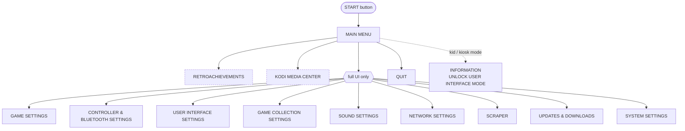
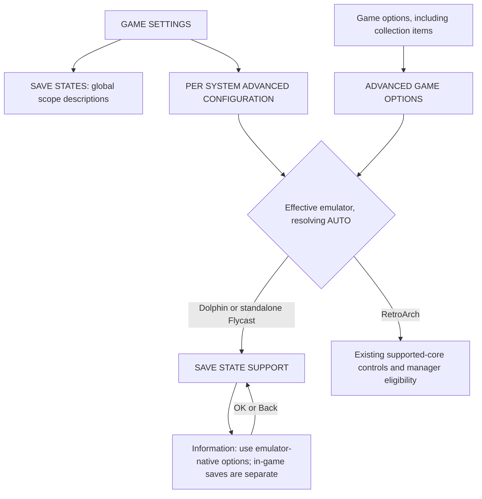
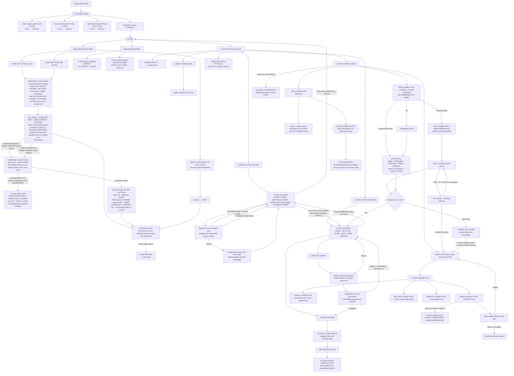
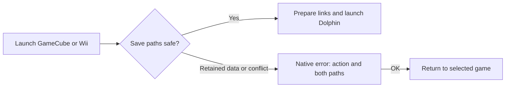
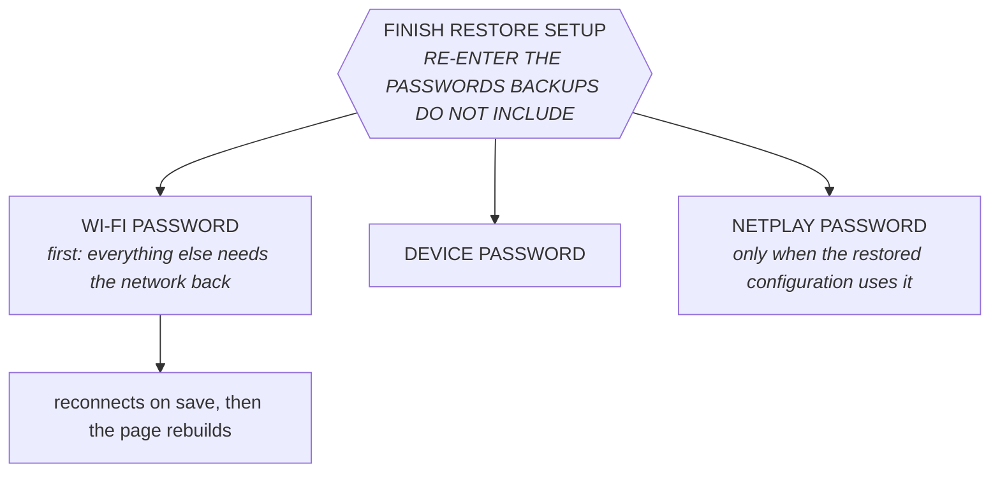
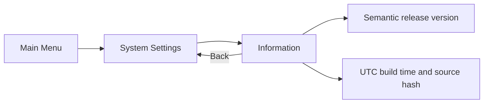
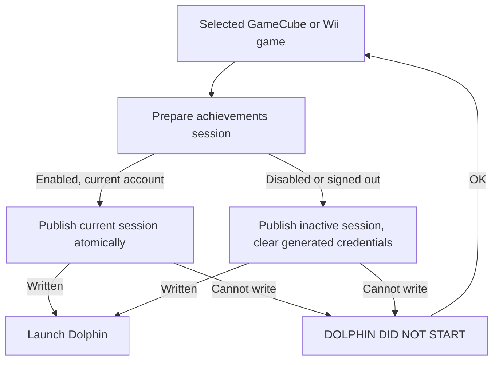
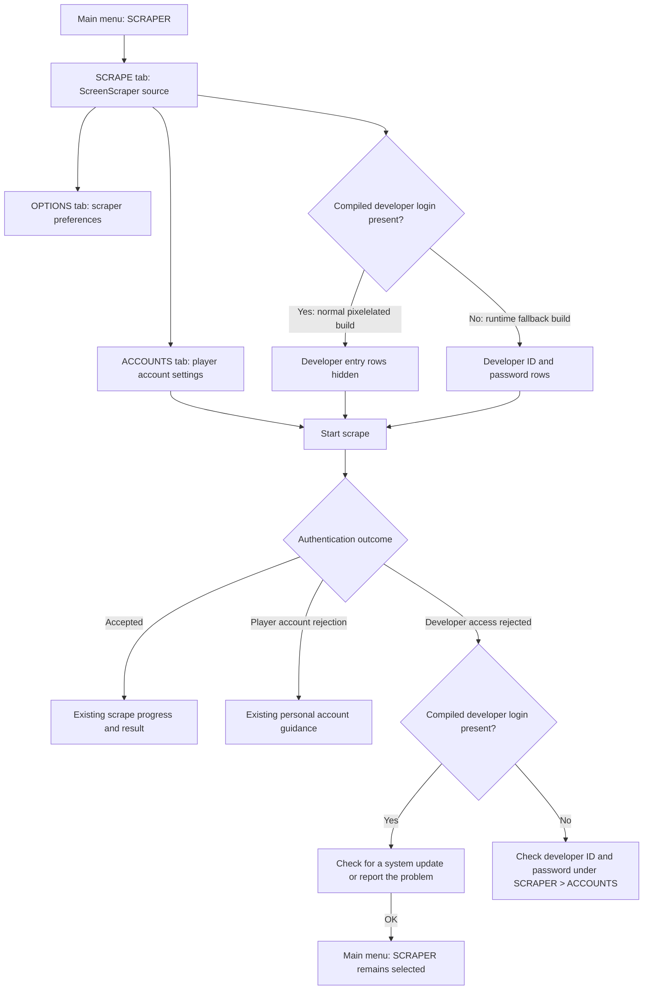

# EmulationStation menu map

Where every screen lives, so a new feature can be placed rather than invented.
Derived from `es-app/src/guis/` in `ROCKNIX/emulationstation-next` (surveyed
2026-08-19 against the `20260818` build) and verified against the running UI with
`tools/vm-visual-qa`.

Companion documents: [es-ui-style-guide.md](../.claude/rules/es-ui-style-guide.md) — how a screen
should look and behave once you know where it goes; and
[conflict-wizard-ia.md](conflict-wizard-ia.md) — the flow and screen structure
for the cloud-save conflict wizard (#23).

## Frontend startup readiness

#529 changes service startup timing, with no new screen, menu row or player copy.
The Wayland frontend waits for a responsive compositor and active output; a
bounded failure stays in the service journal and retains automatic retry.
The successful destination remains the system carousel. The
[source-overlay proof](qa-logs/2026-10-09-frontend-readiness/README.md) exercises
normal, delayed and unavailable readiness plus retained-storage boot.
Its [frame index](qa-logs/2026-10-09-frontend-readiness/evidence-index.json)
binds the reviewed1280×960 original/fixed carousel frames, which are identical
without masks. This is not a new firmware or device visual-baseline promotion.
The existing cloud and conflict-wizard flows are unchanged.

## Visual evidence and flow coverage

This map is the navigation/IA reference; flow diagrams describe transitions,
and reviewed screenshots show their actual presentation (D-WORKFLOW-155).
An entry needs its happy path and relevant branches, with trigger, result,
source/build, language, panel size and evidence status. A named screenshot
alone is not proof that the expected screen was reached. Uncovered branches
remain explicit; this map does not claim screenshot coverage of every
upstream screen declared under **Not mapped**.

The existing visual regression benchmark is
`$ROCKNIX_ARTIFACTS/rocknix-images/walk-baseline/BASELINE.txt`.
Read back on 2026-10-08, it identifies build `d72084ccad`, accepted on
2026-09-26, and 78 walk frames. `tools/vm-qa` compares through
`tools/frame-diff`, using `tools/vm-walks/claims.txt` for intended changes
and `masks.txt` for measured exclusions. The acceptance record, not the latest
PNG, determines the baseline. This RC work has not replaced it.

| Reference | Scope and evidence entrypoint |
| --- | --- |
| [Cloud folder flow](pixelelated/cloud-folder-flow-review.md#implemented-flow-and-visual-proof) | Current #508/#510 draft: link, selected-category check/create, independent paths, findings, local help, and failure/return branches. Source-overlay proof is distinguished from firmware qualification. |
| [Cloud implementation order](pixelelated/cloud-folder-flow-review.md#m7-implementation-order-and-ownership) | #510 contract, #515 case dispositions, #520 standalone-save coverage and #521 captures with #522/#523 runtime prerequisites, #508 integration, #507 audit and final firmware proof. Ambiguous placement keeps instructions; prospective repair diagrams are not implemented or screenshot-qualified surfaces. |
| [DuckStation screenshot coverage](pixelelated/cloud-folder-flow-review.md#duckstation-screenshot-coverage) | DS01 default and DS02 custom capture paths; existing hotkey and launchers, no new menu. Source controls and actual rendered-capture proof are separate from firmware inclusion. |
| [Conflict wizard](conflict-wizard-ia.md) | Conflict decisions and their branch structure. Current cloud setup changes do not change the conflict algorithm or promote its historical wireframes as new screenshots. |
| [VM QA ledger](vm-qa-log.md) | Recorded image qualifications, walk results and accepted baseline changes. |
| [Walk definitions](../tools/vm-walks/) | Repeatable navigation and state fixtures; evidence is the corresponding reviewed run, not the step file alone. |

Keep this index and the affected flow's evidence table current in the same
change. Screens from a superseded flow remain historical references.

**Required change protocol (D-WORKFLOW-156).** Every ES change reviews its
affected flow; every change to navigation, IA, behavior or displayed content
updates the canonical reference and accompanying reviewed screenshot before
completion or pin promotion. A nonvisual change records the exercised flow
and evidence that its presentation is unchanged. Diagram, code and frame must
describe the same source; the title-coverage check alone cannot establish this.

Each proof packet keeps an `evidence-index.json` alongside its readable flow
table. Its `schema_version` is 1 and its `entries` array records:

| Field | Meaning |
| --- | --- |
| `flow_id`, `branch_id` | Stable flow and state/branch identifiers used in the canonical diagram or table. |
| `document`, `anchor` | Repository-relative canonical reference and its section anchor. |
| `trigger`, `expected_state` | What reaches the frame and what it must show. |
| `source` | Exact ES/distribution commits and tested overlay hashes, or an assembled image identity. |
| `locale`, `width`, `height` | Actual language and captured panel dimensions. |
| `frame`, `sha256` | Packet-relative screenshot path and its digest. |
| `status`, `review` | `reviewed`, `rejected` or `pending`, with the observed outcome and reviewer; pending entries may omit frame/digest. |
| `carried_forward_from` | Optional exact earlier evidence plus an unchanged-input justification; never relabel an old frame as newly captured. |

Store the index in the same commit as the proof and validate its JSON and file
references during review. It is a machine-readable input for future flow
automation, not a claim that all semantic or visual coverage is already
checked automatically. Rejected evidence remains traceable and is never the
accepted reference merely because it is the newest file.

## Two ways in

EmulationStation has **two** entry points, and they lead to different trees:

| Button | Opens | Purpose |
|---|---|---|
| **START** | MAIN MENU | Everything configurable |
| **SELECT** | QUICK ACCESS (system view) / VIEW OPTIONS (game list) | Context actions for what is on screen |

Both are built by the same code (`GuiMenu::openQuitMenu_static` serves QUIT and
QUICK ACCESS), which is why QUIT's rows appear inside QUICK ACCESS.

## Main menu



In **kid or kiosk mode the entire block above collapses** to INFORMATION,
UNLOCK USER INTERFACE MODE, RETROACHIEVEMENTS (if configured) and QUIT. Anything
you add to the full-UI block simply does not exist for those users — which is the
correct default for configuration, but check it deliberately.

## What lives where

The section headers (`addGroup`) are the real information architecture; use them
to decide where something belongs.

| Destination | Groups it contains |
|---|---|
| **GAME SETTINGS** | TOOLS · ACCOUNTS · BIOS SETTINGS · SAVE STATES · DEFAULT GLOBAL SETTINGS · **CLOUD SETTINGS** · SYSTEM SETTINGS (per-system config) |
| **CONTROLLER & BLUETOOTH** | SETTINGS · BLUETOOTH · DISPLAY OPTIONS · BEHAVIOR · PLAYER ASSIGNMENTS |
| **USER INTERFACE** | APPEARANCE · CONTROL OPTIONS · DISPLAY OPTIONS · GAMELIST OPTIONS · ICONS |
| **GAME COLLECTION** | COLLECTIONS TO DISPLAY · CREATE CUSTOM COLLECTION · OPTIONS |
| **SOUND** | VOLUME · MUSIC · SOUNDS |
| **NETWORK** | INFORMATION · SETTINGS · NETWORK SERVICES · SYNCTHING SERVICES · VPN SERVICES · FINISH RESTORE PROCESS (only after a restore) — *no cloud group; D-UI-015/017* |
| **SCRAPER** | tabbed: SCRAPE · OPTIONS · ACCOUNTS |
| **UPDATES & DOWNLOADS** | DOWNLOADS · SOFTWARE UPDATES (`MANUAL UPDATES` on pixelelated 0.0.1; opens the release-page instructions, with no automatic-update, force or branch controls) |
| **SYSTEM SETTINGS** | SYSTEM · HARDWARE · DEVICE · STORAGE · PERFORMANCE · TWEAKS · SUSPEND · LED HARDWARE · ADVANCED |

Two placement rules the existing tree already follows:

- **Read-only facts come before editable settings.** NETWORK SETTINGS opens with
  an INFORMATION group (IP address, internet status) and only then SETTINGS.
- **Destructive and system-level operations sit behind ADVANCED**, inside SYSTEM
  SETTINGS → SYSTEM MANAGEMENT AND RESET, where every row confirms first.

## Game list views

The lists a system opens on, and the carousel above them (T32, #679, PL-15;
D-UI-039). None of these pages carries a screen title, so
`tools/es-menu-map-check` cannot see them; they are mapped here by hand.

- **The styles.** `basic`, `detailed`, `video`, `grid` and `gamecarousel`, or
  `automatic`, which takes the first the theme draws (`ViewController.cpp:703-731`).
  Which ones exist is the theme's: the shipped theme draws neither `grid` nor
  `gamecarousel` (G-02 on the M6 image, `docs/audits/2026_10_27-epic-m6-es-app-views-scrapers/02-forward-audit.md`
  § The guest cycle), so a style it lacks falls back to `automatic`.
- **Where a style is chosen.** For every system: MAIN MENU > USER INTERFACE
  SETTINGS > THEME CONFIGURATION > GAMELIST VIEW STYLE (`GuiMenu.cpp:8691`,
  `:8729`). For one system: SELECT on its list > VIEW OPTIONS > GAMELIST VIEW
  STYLE (`GuiGamelistOptions.cpp:194`, `:229`).
- **What acts on a list from VIEW OPTIONS.** JUMP TO GAME BEGINNING WITH THE
  LETTER (`GuiGamelistOptions.cpp:101`, `:127`) moves the cursor to the first
  game under a letter. The carousel's fast move is not a row: the shoulder
  buttons (and the directions, with the `QuickSystemSelect` setting on) step ten systems, or
  a manufacturer or hardware group (`SystemView.cpp:282-334`).
- **The list's help bar** (#210, `ISimpleGameListView.cpp:681-742`, one bar
  for every style): BACK, CHOOSE, GAME OPTIONS (HOLD) -- or SAVE STATES (HOLD)
  when GAME OPTIONS AT NORTH is on and the cursor is a RetroArch game whose
  system keeps save states -- OPTIONS, the north/west pair (FAVORITE, SYSTEM),
  SEARCH and RANDOM. French: SAUVEGARDES D’ÉTAT (MAINTENU) since #1265.
- **The SCREENSHOTS list** is the `imageviewer` system's: the captures, each
  tile turned and shaped by its record (`DisplayAspect`, D-UI-080/081).
- **The carousel's two dialogs**, when no system is left to show: EVERY SYSTEM
  IS HIDDEN IN THIS MODE. SWITCHING BACK TO THE FULL MODE. / TOUS LES SYSTÈMES
  SONT MASQUÉS DANS CE MODE. RETOUR AU MODE COMPLET. (`SystemView.cpp:236`,
  #1265, the mode switch saved), and ERROR: EVERY SYSTEM IS HIDDEN,
  RE-DISPLAYING ALL OF THEM NOW (`:245`, when HIDDEN SYSTEMS is cleared). Each
  is one OK.

## Save state manager

A game's long-press menu > SAVE STATES, or before every launch under GAME
SETTINGS > SAVE STATES > SHOW SAVE STATE MANAGER. The tiles are START NEW GAME,
START NEW AUTO SAVE (only while no auto save exists), AUTO SAVE, and one per
numbered slot -- dated and newest first under INCREMENT PER SAVE, `SLOT n` under
DO NOT INCREMENT (D-UI-059). A tile's time follows SHOW CLOCK IN 12-HOUR FORMAT
(D-UI-058) and is said relative to today (D-UI-087, D-UI-089): `TODAY at 17:07`
(`AUJOURD’HUI à 17:07`) for a save from today, `YESTERDAY at 14:03` (`HIER à 14:03`)
for one from yesterday, and the locale's date with a two-digit year for anything
older, `09/22/26 at 14:03`; the word between is lower-case by the maintainer's
word. Since #196 (D-UI-057) the image ships Batocera's
`es_savestates.cfg` entry and the launcher carries Batocera's contract, so
RetroArch does the loading and the saving itself and the interface never parks
or restores a file: **LAUNCH on a numbered slot** starts RetroArch on that slot
(`-e <n>`), which becomes its current slot, and with AUTO SAVE/LOAD on quitting
writes RetroArch's exit auto save as on any other run -- the AUTO SAVE tile
then shows the quit time and the slot's file is untouched (before, the
interface put the pre-launch auto save back and the quit state was lost);
**LAUNCH on AUTO SAVE**, like a plain launch with AUTO SAVE/LOAD on, auto-loads
that file and quitting overwrites it, as before; **START NEW GAME** runs with
the exit auto save and auto-load off for that session, so it still writes no
auto save and the existing one is kept, as upstream. INCREMENTAL SAVE STATES
offers INCREMENT PER SAVE and DO NOT INCREMENT; INCREMENT SLOT went with
Batocera's `001-no-next-slot` patch, under which the launched slot is the
current slot, never the next free one.

Current unchanged RetroArch flow is also bound by [#606 proof](qa-logs/2026-10-15-retroarch606-proof03/README.md): [empty manager](qa-logs/2026-10-15-retroarch606-proof03/frames/manager-before.png), [manual-save notification](qa-logs/2026-10-15-retroarch606-proof03/frames/manual-saved.png) and [numbered plus exit-auto manager](qa-logs/2026-10-15-retroarch606-proof03/frames/manager-after.png). Exact077197/ES16dbac frame index, process/stat/wait records and original fixture/readback limits accompany this nonvisual qualification; no UI behavior changed.

### Save-state capability guidance (#575)

The current source retains the global SAVE STATES controls, values, and
ordering. AUTO SAVE/LOAD explains that it applies only to supported emulators;
SHOW SAVE STATE MANAGER explains that the manager is for RetroArch. This is
installed guidance at ES `16dbac5211eea7e70db7394372033be2be7df829`, verified on
the final engineering image from distribution `f8636de1d105275dbf9420bbabbbc26f79abb10f`.



SAVE STATE SUPPORT sits immediately after EMULATOR and before SYSTEM OPTIONS.
It is informational and never launches a game or changes a save preference.
Changing the emulator rebuilds the page and updates the row; a collection item
uses its original system. The dialog says:

> THE AUTO SAVE/LOAD SETTING AND SAVE STATE MANAGER DO NOT APPLY TO THIS EMULATOR.
>
> USE THE EMULATOR'S OWN SAVE OPTIONS. IN-GAME SAVES ARE SEPARATE.

The [reviewed candidate frame index](qa-logs/2026-10-13-library-vm/frame-index.json)
binds EN/FR, 640×480/1280×800 screens to ES `bb9e2785f88c`. Its rejected French
description frames remain failure evidence. Follow-up catalog-only candidate
`09afa4893a6a` shortens the global auto-state, global manager, and per-game
state descriptions. Compilation and the [replacement French640/1280 frames](qa-logs/2026-10-14-offline-components/frame-index.json) now pass, with no game launch and preserved preferences. The
[prepared capability matrix](qa-logs/2026-10-13-save-capability-source/flow-and-vm-fixtures.md)
keeps engine save/load observations separate from menu proof. Synthetic GameCube
system declarations supply the VM menu fixture; no Dolphin engine ran in these
UI cases. Existing manager, numbered-slot, and ordinary game-save semantics
above remain unchanged.

The final installed ES16dbac/f863 [native-state readback](audits/2026_10_14-milestone-m7-next-candidate/native-state02-readback.md)
and [exact-source frame index](audits/2026_10_14-milestone-m7-next-candidate/supplements/native-state02-result/frame-index.json)
verify the Wii and Dreamcast per-game selection/support dialogs, global Off/On
screens, native save/load completion, and return to ES. With global On and
Flycast native automatic saving Off, normal exit preserves the manual state's
hash and timestamp. With global Off and native automatic saving/loading On,
normal exit saves the changed scene and the next cold launch restores it before
input. Dolphin's manual restore returns the paused later scene to the earlier
unpaused timer. These are VM software observations; they do not claim physical
handheld performance or replace separate ordinary game-save evidence.

## Cloud (our subtree)

**Current source and image boundary.** Engineering replacement19 uses
ES `c8dc72cf9ec00ab00d6c4a9fcdcea1746c6f1f78` and distribution
`a0f60255abfefaddce772d0bba29977bafb7adab`. Its installed selected-folder,
connection, scan and restore flows are qualified in the
[replacement19 packet](qa-logs/2026-10-11-installed-ui/README.md).
Automatic folder discovery/migration and the former setup-complete screen are
retired. The older ES5d2f/4e410 maps are historical, retained at
[published source240e2b0c](https://github.com/pixelelated/distribution/blob/240e2b0caa1edf7061f633a13d3696ea46c50370/docs/es-menu-map.md).
The owner's deployed engineering firmware remains its separately accepted
8b5113fa16 source; this reference does not imply another device update.

The entrypoint mapped since 2026-09-12 (ES `51639dd09`) remains one door:
`GAME SETTINGS > CLOUD SETTINGS`. The three save actions sit at that level
because saves move constantly; everything occasional is one row further in,
behind MANAGE CLOUD STORAGE (D-UI-021 lineage; the vocabulary is D-UI-022 and
D-CLOUD-049/050: *saves*, *settings*, *ROMs and BIOS*, *game content*;
*back up* and *restore*, with *sync* reserved for the automatic behaviour,
D-UI-040). `NETWORK
SETTINGS` carries no cloud group. The relink row and its page are called
FINISH RESTORE PROCESS (D-UI-046). Rows are a label and at most one line
under it (D-UI-023); the line under a launching row is how it last went
(`LAST <date> - <outcome>`, D-UI-029), read uncached from
`/storage/.cache/cloud_sync/last-<name>`.



**Category-based cloud setup (#508/#510, D-CLOUD-175/178).** This map describes the replacement
being qualified, not the accepted firmware built earlier on 2026-10-07.
Fresh setups use `/pixelelated`; existing sign-ins and selected paths stay as
they are. Scans read folder availability without joining or following another
device's selection. There is no move/retry page, optional TIDY row or startup
migration step. Settings-restore completion closes its own page. Linking opens
the category choices; it does not create every tier automatically. CHECK
FOLDERS reads only the chosen categories, and CREATE FOLDERS has its own
confirmation. Results distinguish missing, empty, present, misplaced, and
unreadable. They establish folder readiness, not file integrity or BIOS
compatibility. Changes to the saves, settings, and shared content paths are
independent. Transfer previews bind their results to the run, configuration,
category mode, and output bytes; a changed selection requires a new check.
Category switches scope these actions; they do not enable automatic sync.
MANAGE CLOUD STORAGE is the entry row; the page it opens is titled CLOUD.
BACKUP AND RESTORE, SAVE MANAGEMENT and CLOUD STORAGE SETUP are groups on
that page, not separate screens. The empty-library finding names the selected
folder and content rather than implying that the whole cloud was searched
(#514); shared ROM/BIOS/game-content guidance stays category-neutral.
The [flow evidence table](pixelelated/cloud-folder-flow-review.md#implemented-flow-and-visual-proof)
tracks the happy path and branching cases with their screenshot status.
Earlier migration rules and frames remain historical evidence under
#356/#363/#502. Website guide publication remains separate under #511.

**Dialogs the cloud raises on its own.** A restore against a cloud whose saves
folder is missing ends COMPLETED and offers to create it (D-CLOUD-085); when a
folder with a near name sits beside the missing one the dialog names both and
offers CHANGE FOLDER · CREATE ANYWAY · NOT NOW (D-CLOUD-091). Both surfaces
raise it in the same words (`CloudOffer::present`, #145): the card, as it
fades, for the save rows in GAME SETTINGS; the transfer page, when the player
dismisses the done page, for RESTORE FROM THE CLOUD -- until #145 only the
card did, and the fresh handheld's route saw nothing. BACK UP / RESTORE
on a device with no cloud storage asks SET IT UP NOW? and YES opens the list.
FINISH RESTORE PROCESS (after a settings restore) tells the player the backup
never carried the cloud sign-in and points at MANAGE CLOUD STORAGE (D-CLOUD-087).

**Ordinary sync and missing folders (#354/#508).** Startup and exit syncs
retain their bounded behavior and existing missing-folder outcome. Explicit
save restore/sync can still offer to create a missing selected saves folder;
that offer does not move an older library. BACK UP TO THE CLOUD and RESTORE
FROM THE CLOUD open their transfer choices after the read-only scan. The
retired #363 boot step no longer intervenes, including after settings restore.

**Since RC-11, and since D-UI-078 (#187, #192, #241).** A transfer started from BACK UP TO THE CLOUD, RESTORE FROM THE CLOUD or MATCH runs on a page that owns the screen until it ends; the one way out while it runs is CANCEL, which asks first and names what cancelling means (`WHAT'S ALREADY IN PLACE STAYS. THE NEXT BACKUP OR RESTORE FINISHES WHAT THIS ONE DIDN'T.`), then stops the run and ends the page on `SKIPPED - YOU CANCELLED IT`. (For a week in RC-11 the page could be left with B and the row that launched it followed the run; D-UI-078 reversed that on 2026-09-21 -- "we should only allow things to run in the background when they're fast" -- and this paragraph described the reversed design until audit #258 PL-006.) After the run ends and its page is dismissed, the row that launched it reads `LAST <date> - COMPLETED` (or `COULDN'T FINISH` / `SKIPPED - ...`) until the outcome page has been seen once, then goes back to its one-line description (D-UI-070); the other two rows dim while one is current. Launching a game while a sync runs asks -- the sentence naming it, then STOP IT AND PLAY or KEEP WAITING (D-CLOUD-129 for the sync the player started, since RC-12 build 4; D-CLOUD-130 for the automatic startup and after-a-game syncs, since build 7; until then the first were refused and the second cancelled without asking); the same question guards a transfer that is current, which with the page sat in is not a state a press can reach. The startup card's first step reads `CHECKING THE CONNECTION...` when the interface sees a link and `WAITING FOR A NETWORK, UP TO 60 SECONDS...` when it does not; `SKIPPED - YOU'RE NOT ONLINE` follows the wait as before.


### Dolphin save-location refusal (#581, candidate)

Before a Dolphin launch, existing private state directories or conflicting memory
cards are preserved. A refused preparation returns through runemu to ES's native
error dialog: localized title, a request to back up and organize the conflicting
locations, both paths, and confirmation that no saved data was deleted. OK returns
to the same selected game. The engine is not launched on refusal.



[Source-bound reviewed frames](qa-logs/2026-10-13-library-vm/dolphin-frame-index.json)
cover French retained-state/card refusals and English fresh Wii setup at1280×800,
using complete staged90cd callers and compiled ESbb9e with recording engines.
The [October14 component frames](qa-logs/2026-10-14-offline-components/frame-index.json) add the remaining640×480 callers. Candidate1a7714fd81 inserts a display-only break at the folder/filename boundary for known long card paths; French640 is reviewed; [updated English640](qa-logs/2026-10-14-dolphin-english640-runtime/frame-index.json) now has reviewed entry/refusal/return frames and exact retained-data preservation under the same helper. Those frame records retain their original staged-caller scope. Later [final clean/retained image evidence](qa-logs/2026-10-15-final-engineering-result/README.md) binds installed f863 scripts and ES16dbac; [ordinary-save evidence](qa-logs/2026-10-15-native-gameplay-result/README.md) remains bound to d4af, while [final native-state reconciliation](audits/2026_10_14-milestone-m7-next-candidate/phase7-final-reconciliation.json) binds the separate four-launch f863 proof. No historical recording-engine result becomes native-engine evidence.
The [initial failed fixture](qa-logs/2026-10-13-library-vm/dolphin-initial-frame-index.json)
retains its own outcome; the source and screenshots are not a promoted product pin.


### FINISH RESTORE SETUP (the checklist after a settings restore)

`GuiMenu::openRestoreRelink`, subtitled *RE-ENTER THE PASSWORDS BACKUPS DO NOT
INCLUDE*. It exists because no credential travels in a settings archive
(D-RA-025, D-INFRA-010): `write_archive` deletes every `.key`/`.password`/`.token`
line from the archived `system.cfg` and blanks the same in `retroarch.cfg`, so a
restored device comes back with its configuration and none of its secrets. Each
row is a state row -- a check-circle when the credential is present, an empty
circle when it is not, deliberately never a warning triangle, because "not set
yet" is the expected state on arrival.



Wi-Fi comes first by design: the sanitised `system.cfg` drops `wifi.key`, so a
settings restore disconnects, and the cloud-journey continuation that follows
this page needs the link back.

## Network (our rows)

`NETWORK SETTINGS > SETTINGS`, as built for #191 (2026-09-15), reworded for
RC-12 build 1 on the maintainer's two calls (D-UI-061, D-UI-062) and reshaped
for build 2 on their third: the phone paradigm (#201, D-UI-063, D-UI-064).
Wi-Fi is NetworkManager: it keeps a profile for every network the device has
joined and autoconnects to whichever saved one is in range, so the network the
device is on and the one the player configured last (`wifi.ssid`) are two
different facts. The row used to show -- and edit -- the setting as though it
were the connection.

```mermaid
flowchart TD
    NET[NETWORK SETTINGS] --> SSID[WI-FI NETWORK  <i>the network the device is on . NOT CONNECTED . COULDN'T CHECK</i>]
    SSID -->|A| PICK{{WI-FI NETWORKS: the networks in range, the joined one first<br/>Home Wi-Fi  CONNECTED . Cafe: Guest  SAVED . Library<br/>REFRESH . INPUT MANUALLY . BACK}}
    PICK -->|initial scan or REFRESH| SEARCH[Same picker and footer; in-list SEARCHING WI-FI NETWORKS<br/>retain previous rows; block scan/row actions while pending]
    SEARCH -->|success, rows available| PICK
    SEARCH -->|success, zero rows| EMPTY[Same picker: NO WI-FI NETWORKS FOUND<br/>REFRESH . INPUT MANUALLY . BACK]
    SEARCH -->|scan failed| FAILED[Same picker: COULDN'T SEARCH WI-FI NETWORKS. TRY AGAIN.<br/>SHOWING PREVIOUS RESULTS when available]
    EMPTY -->|REFRESH| SEARCH
    FAILED -->|REFRESH| SEARCH
    SEARCH -->|back/exit| EXIT[Close picker safely; bounded read finishes without a GUI callback]
    PICK -->|several matching profiles, none preferred| PROFILES[SAVED NETWORKS: choose the named profile]
    PROFILES --> OPT
    PICK -->|A on SAVED| OPT[name IS SAVED.<br/>CONNECT WITH ITS SAVED KEY, OR FORGET IT?<br/>CONNECT . FORGET . CANCEL -- D-UI-118]
    OPT -->|CONNECT| JOIN[CONNECTING TO WI-FI -- wifictl join, the key NetworkManager holds;<br/>toast CONNECTED TO name; the page rebuilt]
    OPT -->|FORGET| ASK
    PICK -->|A on CONNECTED| JOIN
    PICK -->|A on an unsaved network| SECURITY{CHECKING WI-FI NETWORK}
    SECURITY -->|confirmed open| OPEN[CONNECTING TO WI-FI -- connect-open, no password]
    SECURITY -->|protected or unknown| KEY[WI-FI KEY -- on-screen keyboard]
    OPEN -->|changed, unavailable or failed| REFRESH[Refresh the network list and try again]
    KEY --> CONN[CONNECTING TO WI-FI -- wifictl connect, a new profile;<br/>toast CONNECTED TO name; the page rebuilt]
    JOIN -.->|refused| ERR3[COULDN'T CONNECT TO name. IF ITS KEY HAS CHANGED, FORGET IT UNDER MANAGE SAVED NETWORKS AND JOIN IT AGAIN WITH THE NEW KEY.]
    CONN -.->|refused| ERR4[COULDN'T CONNECT TO name. CHECK THE KEY AND TRY AGAIN.]
    NET --> MN[MANAGE SAVED NETWORKS]
    MN --> PAGE{{MANAGE SAVED NETWORKS}}
    PAGE --> ROWS[SAVED NETWORKS: one row per profile, the name as NetworkManager has it;<br/>CONNECTED beside the one the device is on (was IN USE until #308 F-WF-11: the picker, the toast and the forget dialog all say connected); NO SAVED NETWORKS when there are none]
    ROWS -->|A| ASK[FORGET name?<br/>YOU'RE CONNECTED TO IT NOW, SO YOU'LL BE DISCONNECTED. -- when in use<br/>THIS DEVICE WON'T JOIN IT AGAIN ON ITS OWN.<br/>YES . NO]
    ASK -->|YES| DONE[page rebuilt from NetworkManager; toast: name : FORGOTTEN<br/>or name : FORGOTTEN, AND YOU'RE DISCONNECTED]
    ASK -.->|delete refused| ERR[COULDN'T FORGET name. TRY AGAIN.]
    MN -.->|list unreadable| ERR2[COULDN'T READ THE SAVED NETWORKS. TRY AGAIN.]
```

- **The WI-FI NETWORK row's value is the network the device is on now**
  (D-UI-063; the label is D-UI-071, WI-FI SSID until RC-12 build 6), asked of NetworkManager (`wifictl current`) off the interface
  thread as the IP ADDRESS and INTERNET STATUS rows are: CHECKING... until
  the answer, then the name, NOT CONNECTED when the device is on none, or
  COULDN'T CHECK when NetworkManager itself did not answer -- two different
  facts, and the row does not read the second as the first. Maintainer,
  2026-09-15: the value should be the connected network, as on a phone. The
  setting `wifi.ssid` still exists and follows the player's choice (the
  picker's connect writes it; `wifictl join` moves it onto the joined
  network from the profile, key included, never printed) so the paths that
  connect from the settings -- the ENABLE WI-FI switch, the restore wizard
  -- name the network the player is on. No line under the label: build 1's
  `CONNECTED TO <other>` line existed only because the value was the
  setting. **No WI-FI KEY row** since D-UI-118 (2026-09-29, taken from
  ROCKNIX's own saved-Wi-Fi work): a key field with no network beside it
  asked "which network's key?"; the two places a key is typed are the
  picker's WI-FI KEY page, per network, and the restore wizard's WI-FI
  PASSWORD page.
**Implemented picker — #577 / D-UI-127, ES3178 in the fac608ff engineering image:**
The list and footer keep their screen-relative geometry across first search and
refresh. Searching appears inside a reserved status band; existing results remain
visible while scan actions are blocked. Long results scroll inside the fixed
viewport. An unchanged refresh preserves the list/scroll directly; changed rows
restore the selected SSID, or the nearest surviving index if it disappeared.
Completed empty and failed scans have distinct outcomes; failure retains the
last usable rows and offers refresh. Back closes the picker safely. Its bounded
read may finish after closure; reopening attaches to that pending read instead
of launching a second one. No worker owns a GUI callback.

[EN/FR640×480 and1280×800 UI/lifetime/route proof](qa-logs/2026-10-13-setup-qualification/installed/README.md),
[compiled French hint follow-up](qa-logs/2026-10-13-library-vm/README.md), and
[final installed backend/selection/connected/forget proof](qa-logs/2026-10-15-wifi-remaining-result/README.md)
compose the acceptance. The final [24-frame reviewed index](qa-logs/2026-10-15-wifi-remaining-result/frame-review.json)
binds actual installed ES/wifictl bytes and branch outcomes. Enumeration and
profiles are synthetic; this is not a physical-radio measurement.

The #593 normal-exit correction makes the scan worker process-owned and joins it
at normal frontend exit. [Actual frontend evidence](qa-logs/2026-10-15-audit-ui-results/README.md)
reproduces two baseline scan survivors and verifies candidate ES16dbac stops and
joins them without observer cleanup. Existing picker labels/layout remain the
same. The [focused Back/reopen continuation](qa-logs/2026-10-15-wifi-normal-exit-result/README.md)
and [reviewed frame index](qa-logs/2026-10-15-wifi-normal-exit-result/frame-index.json)
verify actual key send to a complete matching return frame within59.1ms, with
reopening attached to the same pending scan and no second enumeration. The
prior host timing failure remains recorded. Normal frontend exit joins the scan;
SIGTERM/fatal exits remain separate (D-CLOUD-133).

The final f8636de1 image with installed ES16dbac now passes both the
[clean-install flow and four reviewed frames](qa-logs/2026-10-15-final-engineering-result/clean/README.md)
and [retained-upgrade flow and four reviewed frames](qa-logs/2026-10-15-final-engineering-result/retained/README.md).
The installed executable is used directly. Back restored the exact full reference
in57.909324ms and57.258077ms respectively; reopening reused the scan and normal
exit left no survivor. Presentation is unchanged. These remain synthetic backend
checks; they do not measure a physical radio.

The [October13 baseline](qa-logs/2026-10-13-library-wifi-baseline/README.md)
retains the former external overlay, growing initial geometry and identical
empty/error outcomes. Populated refresh retained dimmed prior rows; its alleged
disappearance was not reproduced. Those historical defect frames stay unchanged.

- **The picker (WI-FI NETWORKS)** lists the networks in range (`wifictl
  list`, with in-list search status), the joined one first and marked
  CONNECTED, the ones NetworkManager holds a profile for marked SAVED
  (`WifiText::pickerRows`, unit-tested); a saved network out of range is not
  a row (D-UI-064) -- this list is what can be joined from here. A on a
  saved row opens CONNECT / FORGET / CANCEL (D-UI-118, the second choice
  taken from ROCKNIX's own work; CONNECT first, back lands on CANCEL):
  CONNECT joins it with the key NetworkManager holds (`wifictl join`:
  `nmcli connection up`, then the settings follow, then `pin` prefers it at
  the next boot and resume), FORGET runs the manage page's own confirmation
  and reader (one function, `GuiMenu::forgetWifiNetworkWithConfirmation`)
  and rebuilds the picker; A on the connected row joins it again at once
  (the press confirms or repairs). Unsaved rows first check advertised
  security: confirmed open networks connect without a password; protected
  or unknown networks retain the WI-FI KEY editor (START accepts). The
  open operation rechecks security and saved profiles before connecting,
  never invents a key, and advises refreshing the list if it fails. INPUT
  MANUALLY checks the same saved-profile mapping and security; an unscanned
  hidden network keeps the key editor. Profiles are matched by the SSID in
  `wifictl saved --ssid`, not by their editable profile name. When several
  profiles match without an unambiguous preferred profile, a SAVED NETWORKS
  page asks the player to choose before CONNECT or FORGET. Unknown saved
  metadata offers a fresh check rather than treating it as an unsaved network. On success a toast CONNECTED TO
  <name> and the page is rebuilt so every row reads the connection back;
  failures are dialogs naming the network. Before this, picking a network
  the device had joined before ran `wifictl connect` with whatever key sat
  in the WI-FI KEY row (a row that no longer exists), which deletes the
  saved profile and rebuilds it with that key.
- **MANAGE SAVED NETWORKS** (D-UI-062: "saved" is the maintainer's word and
  `wifictl`'s, and the page, its group and its dialogs use no other) sits
  with the Wi-Fi rows (Wi-Fi on, not LOCAL PLAY MODE). Its page lists
  `wifictl saved --ssid` -- NetworkManager's wireless profiles, the one in use
  first as nmcli orders them -- behind a spinner,
  since one nmcli call is one D-Bus round trip to a service that can stop
  answering (#102). A on a row confirms, YES first, so B answers NO; the
  help bar names A FORGET only while there is a network to forget. FORGET
  deletes the profile (`wifictl forget <name>`): the device stops joining
  that network on its own and the password NetworkManager held goes with
  it; `wifi.ssid` and `wifi.key` are untouched, so the network the player
  configured is still one press away in the picker. Forgetting the one in
  use disconnects the device at once (NetworkManager may then join another
  saved network in range), and the toast says so. A list that could
  not be read is a dialog, not an empty page: an empty list and no list are
  different answers, in the script (exit 1) as on the screen.

## RetroAchievements (our rows)

`GAME SETTINGS > RETROACHIEVEMENTS SETTINGS > OPTIONS` carries one row of the
fork's under HARDCORE MODE: OFFLINE ACHIEVEMENTS (BETA) / `Casual achievements
only.` with an arrow (D-RA-003, D-UI-053), shown only where
`/usr/bin/raofflineproxy-ctl` exists. Its page (as built for the eighth candidate,
2026-09-14, #165/#173/#179/#184/#189; D-RA-002..005, D-RA-010, D-RA-012, D-RA-013,
D-UI-054):

```mermaid
flowchart TD
    RAS[RETROACHIEVEMENTS SETTINGS] --> OA[OFFLINE ACHIEVEMENTS (BETA)<br/><i>Casual achievements only.</i>]
    OA --> PAGE{{OFFLINE ACHIEVEMENTS (BETA)}}
    PAGE --> SW[OFFLINE ACHIEVEMENTS (BETA) switch] -->|on| TURNON[dialog: beta, casual only, hardcore off;<br/>with the startup index off: IT ALSO TURNS ON INDEX NEW GAMES AT STARTUP...<br/>TURN ON . NOT NOW]
    TURNON -->|TURN ON, online| SCANNOW[SCAN GAMES FOR OFFLINE ACHIEVEMENTS NOW?<br/>the scan's sentence<br/>SCAN NOW . LATER]
    TURNON -->|TURN ON, no address| NOTONLINE[YOU'RE NOT ONLINE. SCAN GAMES FOR OFFLINE ACHIEVEMENTS WHEN YOU'RE CONNECTED...<br/>OK]
    PAGE --> I1[one block, after the two options and a half-line gap: EARN CASUAL ACHIEVEMENTS WITHOUT A CONNECTION. THEY ARE SENT WHEN YOU'RE BACK ONLINE. CASUAL ACHIEVEMENTS ONLY, SO TURNING IT ON TURNS HARDCORE MODE OFF. '!RA!' IN A GAME'S CORNER MEANS AN ACHIEVEMENT HASN'T REACHED RETROACHIEVEMENTS YET. NEW GAMES ARE ADDED THE NEXT TIME YOU'RE CONNECTED.]
    PAGE --> SCAN[SCAN GAMES FOR OFFLINE ACHIEVEMENTS<br/><i>NOT SCANNED YET . N GAMES READY FOR OFFLINE PLAY</i><br/><i>LAST date - COMPLETED or COULDN'T FINISH . N GAMES READY FOR OFFLINE PLAY</i><br/><i>WHEN YOU CAME ONLINE - outcome . N GAMES READY ...</i><br/><i>SCANNING... - GAME i OF n . N GAMES READY (a scan left running with B, PL-07)</i><br/><i>SAVING GAMES FOR OFFLINE PLAY... - GAME i OF n . N GAMES READY (a top-up the ctl runs, #189; refreshed once a second)</i>]
    SCAN -.->|switch off| DIM1[dimmed: TURN ON OFFLINE ACHIEVEMENTS FIRST.]
    SCAN -.->|no address| DIM2[dimmed: YOU'RE NOT ONLINE.]
    SCAN --> CONFIRM[SCAN GAMES FOR OFFLINE ACHIEVEMENTS?<br/>what it does and costs; last time's why<br/>YES . NO]
    CONFIRM --> XFER[GuiOfflineScan<br/>full screen; GAME i OF n, the game, counts so far, spinner, elapsed;<br/>outcome and N GAMES READY FOR OFFLINE PLAY; stays until dismissed]
```

The row's line and the page's last screen read the same two files the ctl
and the proxy's client leave under `/storage/.config/raofflineproxy/`:
`last-scan` (`<epoch> <rc> <scan|topup> cached= skipped= ready= limit=
indexed= errors= [why=]`, D-UI-029's shape for this row; `errors` is how
many games a fetch failed for, and such a run ends rc 1 with
`why=SOME_GAMES_NOT_SAVED` -- a token the page renders as SOMETHING WENT
WRONG until it learns the word, audit #186 PL-24) and `cached_game_ids.txt`
(one id per line: the count). Exit 69 and 75 from `raofflineproxy-ctl scan` read
SKIPPED - YOU'RE NOT ONLINE / SKIPPED - A SCAN IS ALREADY RUNNING; 77 and 78
(no account, switch off) COULDN'T FINISH with the reason on line 4. The
automatic top-up (`raofflineproxy-ctl topup`, run by `NetworkThread` when the
device comes online, bounded to one attempt per half hour) had no surface of
its own until 2026-09-26 (#293, D-UI-095): now a card while it has work --
RETROACHIEVEMENTS (OFFLINE) over GETTING GAME N OF M READY..., then COMPLETED
and N MORE GAMES ARE READY. or EVERYTHING'S UP TO DATE., or COULDN'T FINISH
with the ctl's why (D-UI-107) -- and a launch over it asks YOUR OFFLINE
ACHIEVEMENTS ARE BEING UPDATED. / IF YOU STOP IT, IT'LL TRY AGAIN NEXT TIME
YOU'RE CONNECTED. with STOP IT AND PLAY / KEEP WAITING. Its result is still the
same line under the row, with WHEN YOU CAME ONLINE in place of the date
(D-UI-032).

Since the RC-5 round (#184 notes 3b/5b, D-RA-013) the scan and the top-up
follow the interface's own game index: where a system's games carry a
`cheevosHash` (INDEX NEW GAMES AT STARTUP, INDEX GAMES -- in `gamelist.xml`,
or in `recovery/<system>/` until the next clean exit writes it), only the
games with a `cheevosId` are cached, from that id and hash, the ROM never read
again; a system with no index at all is hashed as before. The top-up caches
every indexed game not yet cached (not only the recently played), and
`ThreadedHasher` runs `raofflineproxy-ctl topup --after-index` as it finishes
with the toggle on, so INDEX NEW GAMES AT STARTUP feeds the cache by itself.
While the toggle is on, the two GAME INDEXES rows on RETROACHIEVEMENTS
SETTINGS carry one line each -- INDEX NEW GAMES AT STARTUP / `Also saves new
games' achievement data for offline play.`, INDEX GAMES / `Also saves their
achievement data for offline play.` -- and so does FIND ALL GAMES WITH
NETPLAY/ACHIEVEMENTS under DEVELOPER > TOOLS; off, the rows read as
upstream's. The stamp gains `indexed=<n>`, which the page passes over.

**Elsewhere, cloud-adjacent.** `SYSTEM SETTINGS > SYSTEM MANAGEMENT AND RESET`:
DATA MANAGEMENT (back up / restore settings to this device), EMULATOR
MANAGEMENT and SYSTEM MANAGEMENT (the resets) run headless behind a spinner and
end in an outcome dialog (D-UI-037). `SCRAPER > ACCOUNTS` carries DEVELOPER ID /
DEVELOPER PASSWORD beside the account (#64; the map said OPTIONS until
2026-09-29, `GuiScraperStart::loadAccountsPage` says ACCOUNTS). The startup sync is a card at
boot; the exit sync a card after a game; both end on the card (D-UI-028, with
`COMPLETED WITH GAPS` removed by D-UI-030 -- a run passes or fails). A launch
cancels either **in what ships today** (D-CLOUD-076); **D-CLOUD-109 replaces
that** with a bounded wait, so this line changes when #22/#135 land. Since
2026-09-26 (#292, D-RA-030) the link's return has cards of its own: SENDING
OFFLINE ACHIEVEMENTS... with the count, ending OFFLINE ACHIEVEMENTS HAVE BEEN
SENT (or COULDN'T FINISH - RETROACHIEVEMENTS STOPPED ANSWERING), when the proxy
holds awards or has just sent some; then SYNCING SAVES TO THE CLOUD when the
last exit sync was skipped for no network. A launch over the send asks
OFFLINE ACHIEVEMENTS ARE BEING SENT. / IT'LL BE A MOMENT. with PLAY NOW / KEEP
WAITING (the send is the proxy's and goes on behind the game). The exit card
no longer says anything about achievements. Each card stamps what it said
(`last-sync-link`, beside `last-sync-exit` and `last-sync-startup`).

Anything measured in minutes runs in `GuiCloudTransfer`, not a card
(`es-native-ui.md`, the fourth *surface* tier -- not one of the four data
tiers above). Exit 75 from any script means another
sync held the lock and exit 69 means there was no network (sysexits'
`EX_TEMPFAIL` and `EX_UNAVAILABLE`, codes rclone cannot return -- #99); both
are shown as SKIPPED, not FAILED.

**Keep this map current.** Maintainer, 2026-09-11: it is *"something we were
maintaining closely and should still do"* -- every row added, moved or renamed
in EmulationStation updates this file in the same change (D-UI-039). Pending
here, to be drawn when the rows are built (#134, #23): under SAVE MANAGEMENT one
entering row, EARLIER VERSIONS OF SAVES (D-UI-043: about keeping, no restore verb),
opening a nested page that holds KEEP EARLIER VERSIONS OF SAVES (switch)
and VERSIONS KEPT PER SAVE (count) -- the two #23 rows, reworded for the whole
store (D-CLOUD-095/096, D-UI-039); and, after a conflict, the compare page with
the cloud's version left and this console's right, a *played later/earlier on
<console>* line under each, the cursor opening on the newer one (D-CLOUD-104).

## Not mapped

Upstream Batocera pages this fork neither wrote nor modifies. They are listed
rather than omitted so the check (`tools/es-menu-map-check`) can tell a page we
decided not to document from a page somebody forgot — and so that the day we add
a row to one of them, the declaration is where the reader will trip over it.
**Adding a row to any of these means mapping it above and deleting its line
here.** The reason column is the point; a line with no reason is not a decision.

- SYSTEM OPTIONS -- upstream system page; ROCKNIX adds no row to it
- SECURITY -- upstream; the SSH/root-password surface we use in the wizard is mapped above instead
- FRONTEND DEVELOPER OPTIONS -- upstream diagnostics, not a player surface
- PER SYSTEM ADVANCED CONFIGURATION -- upstream per-emulator tree, unchanged here
- EMULATOR SETTINGS -- upstream per-system emulator/core choice, unchanged here
- LATENCY REDUCTION -- upstream run-ahead page, unchanged here
- MULTISCREENS -- upstream; no ROCKNIX handheld has a second screen
- DECORATIONS -- upstream bezel page; settings backups carry bezels but the page is theirs
- DMD -- upstream pinball display integration, not built for our devices
- FORMAT DEVICE -- upstream storage tool, unchanged here
- SAFELY EJECT A DISK -- upstream storage tool, unchanged here
- KODI SETTINGS -- upstream; Kodi is not in our images
- FAVORITE SONGS -- upstream background-music picker, unchanged here
- SCREENSAVER SETTINGS -- upstream screensaver page, unchanged here
- AI GAME TRANSLATION -- upstream feature, not configured on our images
- SCREENSCRAPER -- existing scraper page and player account rows; #566 provisions the interim developer login and hides its developer-entry rows when compiled in. The flow and qualification boundary are below.
- NETPLAY SETTINGS -- upstream netplay page, unchanged here
- CONNECT TO NETPLAY -- upstream netplay browser, unchanged here
- ADD TO CUSTOM COLLECTION... -- upstream collections flow, unchanged here
- GLOBAL HOTKEYS -- upstream hotkey editor, unchanged here
- JOYSTICKS HOTKEYS -- upstream hotkey editor, unchanged here
- KEYBOARDTOPADS -- upstream key-to-pad editor; #63 will move its tab strip to the focus model, which does not change where it lives
- ANALOG STICKS LEDS -- upstream LED page for controllers our devices do not have
- PAIR A BLUETOOTH DEVICE -- upstream pairing flow, unchanged here

## pixelelated identity (0.0.1)

The screenshot toggle in System Settings reads **ENABLE pixelelated SCREENSHOT**;
its persisted `rocknix.screenshot.enabled` setting is unchanged.
The system menu version line and manual-update destination use lowercase
pixelelated (D-WORKFLOW-144, #409). This is a name change within the same rows.

## Build identity in INFORMATION (#530)



The existing VERSION and BUILD ID rows show the release version and, for new
metadata, UTC time with seconds plus12source-hash characters. No community
classification is displayed. Old metadata without BUILD_TIMESTAMP keeps the
source/branch fallback; navigation and labels remain unchanged.
Reviewed640x480 original/new/legacy information frames, exact source binding
and branch expectations: [identity evidence](qa-logs/2026-10-09-build-identity/evidence-index.json).
These are runtime-overlay proofs, not a promoted full-firmware baseline.

## Connection management and open-network proof (#535–#537)

The current source work implements [the connection contract](pixelelated/cloud-folder-flow-review.md#saved-connections-and-sign-in-recovery).
The [reviewed flow table](qa-logs/2026-10-11-network-cloud-management/frame-index.md)
and [schema1 evidence index](qa-logs/2026-10-11-network-cloud-management/evidence-index.json)
bind NC01–NC12, WF01–WF07, ED01 and BR01 to source/binary/catalog hashes. EN/FR,
small/large happy, failure, cancellation and return states have actual VM proof.
The independent audit and all seven repairs are complete (#540). Combined-image
qualification remains under #344/#537; the original source-overlay frames do not
replace that installed-image proof. CONNECTION SAVED is the saved-only completion
page: it keeps the active connection unchanged and directs the player to CLOUD
CONNECTIONS when they want to use the saved connection. Reviewed NC08 frames:
[English 640](qa-logs/2026-10-11-network-cloud-management/connections/en640/saved/01-edited-connection-saved.png),
[French 640](qa-logs/2026-10-11-network-cloud-management/connections/fr640/saved/01-edited-connection-saved.png),
[English 1280](qa-logs/2026-10-11-network-cloud-management/connections/en1280/saved/01-edited-connection-saved.png),
[French 1280](qa-logs/2026-10-11-network-cloud-management/connections/fr1280/saved/01-edited-connection-saved.png).
The hand pointer on a browser link remains normal browser feedback. Phone motion,
taps and typing use one ordered input stream; supported sign-in popups preserve
their opener and return to it. User-initiated cross-host navigation keeps the provider/auth-host guard; this is
not a claim of complete redirect or subframe confinement.

### Pending nonvisual allocator candidate (#570)

The cloud sign-in flow and copy remain unchanged. Candidate ESf7b71db0a adds
heap reclamation after frontend teardown. [Actual-source component evidence](qa-logs/2026-10-13-es-trim-product/README.md)
and its [reviewed frame index](qa-logs/2026-10-13-es-trim-product/frames.json)
cover640×480 native input, phone input across navigation, provider-start failure,
Back and browser return. This is a runtime overlay, not a promoted pin or complete
full-image baseline; broader qualification remains open. #571's phone status
layout remains a separate pending change.

### Text editing and browser Back (#538/#539)

The shared text editors label their existing empty-string action CLEAR
(French EFFACER). CANCEL discards the current edit. Other RESET actions keep
their separate meanings. The Add connection name editor reads the latest draft
when reopened, including an empty value; it does not restore the initial suggested
name. An empty or duplicate name is refused before authentication.

In the sign-in window, B/Backspace closes the on-screen keyboard when open.
Otherwise editable fields keep normal deletion; outside an editor, an unmodified,
unhandled Backspace navigates back. Previously handled provider keys and modified
shortcuts retain their behavior. Close exits the window. Supported authentication
popups keep their opener and return to it when closed. These are browser behaviors,
not a changed tablet user agent or a claim that all provider workflows are tested.

## Installed replacement19 qualification

[Installed UI/startup proof](qa-logs/2026-10-11-installed-ui/README.md) and its
[evidence index](qa-logs/2026-10-11-installed-ui/evidence-index.json) bind22
reviewed frames to a0f60255ab/ESc8dc72cf9. INFORMATION displays0.0.1-dev and
UTC/source metadata; clean and retained startup reach the carousel. Same-model
settings restore offers the newest compatible archive, foreign-only stays
disabled, and EN/FR opening/content scans handle positive/empty/failure/retry.
No baseline or screenshot masks are changed by this qualification.

## Unavailable hardware readings (#548)

SYSTEM SETTINGS > INFORMATION keeps its rows and valid hardware measurements.
Missing CPU frequency reads `Not Available` instead of a bare `MHz`; absent
GPU/temperature values are omitted rather than invented. An absent optional
quirk is successful, while a real executed quirk error still fails. The
[three reviewed frames](qa-logs/2026-10-11-optional-hardware/evidence-index.json)
and [full-script proof](qa-logs/2026-10-11-optional-hardware/README.md) bind this
correction to a single script overlay. The corrected assembled replacement20 now
has [eight reviewed clean-install and retained-upgrade frames](qa-logs/2026-10-11-pixelelated-replacement-20/evidence-index.json),
actual installed-script identity, quiet successful execution and positive startup
records. Real19→20 retained-storage qualification also passes under #344.

## Pending allocator candidate: constrained handoff proof (#570)

The nonvisual ES candidatef7b71db0a additionally has a
[constrained-memory comparison and repeated handoff packet](qa-logs/2026-10-13-es-trim-comparison/README.md)
with its [exact-source frame index](qa-logs/2026-10-13-es-trim-comparison/frames.json).
The provider page, keyboard choice and return/reopen states retain their
presentation. Early black return captures are rejected and later frontend
frames are the accepted proof. This is640×480 English software-profile
evidence; standard-profile broader frames and remaining sign-in branches
still precede pin promotion. No new canonical full-image baseline is selected.

### M7 setup candidate under qualification — October 13

The accepted flow/frame baseline above remains historical. The composed source
adds browser-window failure retry/cancel on both keyboard routes, conditional
offline-achievement explanation before Update Gamelists, a fixed Wi-Fi picker
viewport with in-list searching, and corrected absent Recent preference.
[Source and component evidence](qa-logs/2026-10-13-setup-qualification/README.md)
links the reviewed defect/companion frames and actual compile/lifetime results.
The a7 composed source now has [completed installed EN/FR640×480/1280×800
flow evidence](qa-logs/2026-10-13-setup-qualification/installed/README.md) and
a [43-frame reviewed index](qa-logs/2026-10-13-setup-qualification/installed/frame-index.json).
The French Wi-Fi controller hint needs the subsequent source correction and
new frames. Final next-composition and assembled-image proof remain due.
Phone status now occupies a fixed header control; page loading keeps connected
status while field readiness separately gates queued text. Error details overlay
the controls without moving them. [Proposed exact flows](qa-logs/2026-10-13-wifi-picker-source/flow-and-copy.md)
and [browser branches](qa-logs/2026-10-13-library-setup-source/browser-window-failure.md)
are candidate references, not a claim that the accepted image has changed.


### Offline achievements → Dolphin routing (#584)

The existing offline-achievements control and game-launch navigation are unchanged.
The launcher routes a Dolphin launch to127.0.0.1:8080 only when the saved toggle
is exactly1, raw hardcore is exactly0 and an IPv4-capable listener is present.
Otherwise it keeps the configured custom host. The #594 correction atomically
publishes an inactive, credential-free Dolphin session when achievements are
disabled or the account has no token, then retains the existing early exit status.
Global account settings are unchanged. A failed publication refuses the game
launch so an older active session cannot be reused.
[Configuration proof](qa-logs/2026-10-14-rvz-proxy-components/README.md) contains126
before/after full-script cases. Installed proxy hashing, service lifecycle and
startup reconnect now have their own completed evidence; those do not prove
that the default Dolphin process uses the generated HostUrl.

The [NoGUI lifecycle repair](qa-logs/2026-10-15-dolphin-nogui-lifecycle/README.md)
adds the missing AchievementManager initialization/shutdown. The
[compiled candidate and actual-process proof](qa-logs/2026-10-15-dolphin-startup-result/README.md)
reproduces the installed baseline defect and verifies enabled, disabled and early
boot-failure lifecycle branches. One synthetic failed-login request reaches the
configured loopback endpoint. No ES copy/layout changes; the exercised nonvisual
flow is NoGUI startup/configuration and shutdown. Existing settings and game-launch
frames remain the presentation baseline. The subsequent actual installed enabled,
disabled and boot-error startup controls passed; ordinary Wii gameplay/cold-save
proof retains its earlier d4af source identity. The final f863
[native-state flow](audits/2026_10_14-milestone-m7-next-candidate/native-state02-readback.md)
and [reviewed frame index](audits/2026_10_14-milestone-m7-next-candidate/supplements/native-state02-result/frame-index.json)
verify manual restoration and normal frontend return. Listener presence alone
does not establish proxy identity/readiness, and synthetic login is not successful
authentication or an award. Physical-device behavior remains separately scoped.

### Dolphin session publication refusal (#594)

The launch route remains game selection → existing launch preparation → Dolphin.
Both GameCube and Wii launchers use the same status gate. An inactive session
continues into the game with achievements disabled; an update failure returns
through the existing native launch-error modal, then OK returns to the selected
game. No new settings row or account action is introduced.



English title: `DOLPHIN DID NOT START`. Body: `Achievements settings could not be
updated. Check the game storage and folder permissions, then try again.`
French title: `DOLPHIN N’A PAS DÉMARRÉ`. Body: `Les paramètres des succès n’ont pas
pu être mis à jour. Vérifiez le stockage des jeux et les permissions des dossiers,
puis réessayez.` The existing error-250 owner line is consumed by ES and is not
an additional visible title. Saved account settings, pending awards, game saves,
and save states remain untouched. Existing INI bytes remain when publication
fails; the launcher refuses to use them.

[Exact-source EN/FR640×480 and1280×800 refusal/return evidence](qa-logs/2026-10-15-audit-ui-results/README.md)
and its [reviewed frame index](qa-logs/2026-10-15-audit-ui-results/frame-index.json)
now qualify this branch with ES16dbac and the explicit helper/launcher overlay.
The actual API-driven walk returns to its originating Wii system carousel after
OK; selection-driven game-list return is not inferred from those frames. The
positive helper log and target publication error distinguish this from an earlier
save-path refusal. Exact original configuration identities are restored.
The final f8636de1 integrated image has verified installed helper/launcher bytes;
[clean](qa-logs/2026-10-15-final-engineering-result/clean/README.md) and
[retained-upgrade](qa-logs/2026-10-15-final-engineering-result/retained/README.md)
checks pass the four disabled/logged-out/enabled transitions. They use the full
installed helper and exact launcher block with a synthetic engine marker; they
complement the separate refusal frames without claiming a live native login.

## ScreenScraper developer provisioning (#566)

D-WORKFLOW-166 chooses the shared JELOS developer identity for the next build;
replacement credentials are backlog #586. The page's location and personal
account settings stay unchanged. The recipe candidate uses existing compiled-pair
precedence, so a normal build has no developer ID/password entry step. A build
without a compiled pair retains the runtime fallback under #64.



The diagram describes the candidate flow, not an accepted new image.
ES3178b832b8d134198b2b4eede4f725d4ed283f8c corrects the compiled developer
rejection branch: it directs players to a system update or problem report;
it no longer directs them to hidden developer fields. Runtime-only guidance
and personal account errors retain their existing routes. Both credential-mode syntax checks, the compiled-pair component build
and the English/French catalogs pass. Actual EN/FR640x480/1280x800 entry,
options, accounts, rejection and return frames are reviewed and accepted,
with original normal case exits. The [exact-source frame index](qa-logs/2026-10-14-screenscraper-ui-runtime/frame-index.json)
binds the executing ELF/catalogs and20primary frames; the [review record](qa-logs/2026-10-14-screenscraper-ui-runtime/README.md)
retains original failures separately. Final installed-image qualification is distinct.

Qualification records: [interim provisioning](qa-logs/2026-10-14-screenscraper-provisioning/README.md)
and [rejection-copy component](qa-logs/2026-10-14-screenscraper-rejection-runtime/README.md).
Combined installed-image, backup and clean/retained checks remain required.


### Last Played backdrop in the final M7 walks (#578, #591)

The corrected absent collection preference enables the intentionally empty Last
Played collection. Its existing theme artwork shifts the carousel backdrop behind
the unchanged cloud/settings panels. The [78-frame comparison and exact-source
index](qa-logs/2026-10-15-frame-claims/README.md) records the reviewed visible
regions against the historical baseline. New claims cover exposed background;
foreground controls remain checked. This does not replace the canonical baseline.

### Dolphin immutable resources follow-up — #592 (2026-10-15)

The package exposes existing Sys resources at Dolphin's compiled immutable path.
No ES row, navigation or copy changes. Exercise the same native launch/return
flow; the final installed startup proof must verify the previously missing badge
resources and lifecycle. Existing ES frame baselines remain source-bound; this
pending package proof does not establish new visual/gameplay evidence.

### 2026-10-16 — Unchanged browser return flow qualified (#614)

[Exact077197 / ES16dbac VM frames and input evidence](qa-logs/2026-10-16-browser-exit-614/README.md)
exercise Game Settings → Manage Cloud Storage → Cloud Connections → Add connection
→ Dropbox → Sign in → on-screen keyboard → return/cancel. Nine reviewed frames
bind the unchanged presentation; keyboard/uinput/installed-close/loopback phone
handler return to the same frontend. Synthetic local page, not provider login or
physical controller/phone qualification. Initial failed observer is retained;
only the armed-observer repeat is accepted. No navigation or copy change landed.

### 2026-10-16 — Bounded native browser return observation (#615)

[Unchanged077197 / ES16dbac flow and six reviewed frames](qa-logs/2026-10-16-h700-browser-exit-615/README.md)
retain the normal Add connection → Dropbox → on-screen keyboard → return/cancel
flow. Early Escape and normal close return; loaded-page Escape remains unproved
because the longer attempt hits a pressure guard. Black frame after an explicit3-second post-close wait
is explicit; rendered final carousel proves eventual recovery, not latency.
No screen content, navigation, product source or baseline was changed.
