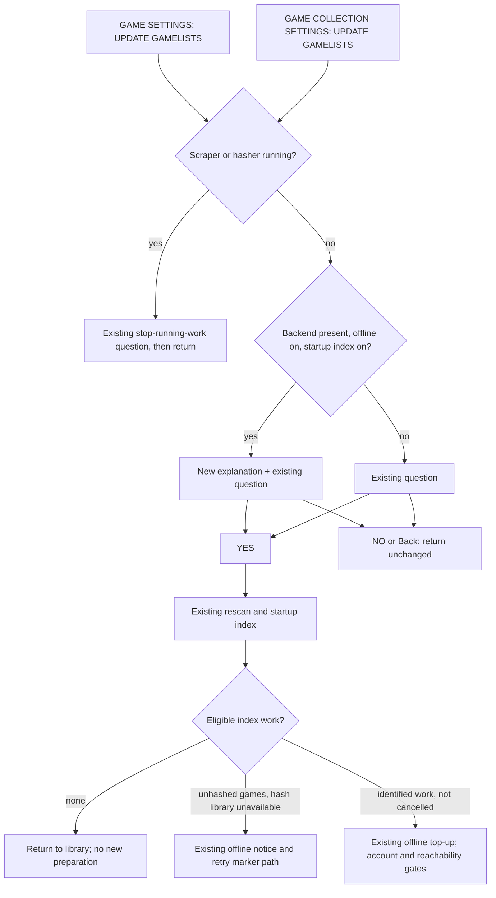

# Proposed canonical additions — UNRUN source candidate

Coordinator: add this flow to `docs/es-menu-map.md` and bind the eventual reviewed
frame index there. This scoped draft is not a second canonical map or an accepted
firmware claim. No conflict-wizard IA changes are involved.

## UPDATE GAMELISTS (#567)

Both `GAME SETTINGS > TOOLS > UPDATE GAMELISTS` and `GAME COLLECTION SETTINGS >
UPDATE GAMELISTS` use the existing YES/NO confirmation. When the ROCKNIX image
carries the offline backend, OFFLINE ACHIEVEMENTS is on, and INDEX NEW GAMES AT
STARTUP is on, the existing question gains this paragraph:

> THIS ALSO CHECKS NEW GAMES FOR OFFLINE ACHIEVEMENTS. AN INTERNET CONNECTION IS
> NEEDED TO DOWNLOAD THEIR ACHIEVEMENT DATA.

A blank line separates it from `REALLY UPDATE GAMELISTS?`. The question, YES,
and NO reuse existing translations. The exact new French entry is in
`copy.fr.po`; there is one new msgid, no placeholders or embedded line breaks.
No extra confirmation, automatic setting change, connectivity probe, or account
check is added. With any predicate false, the original question appears alone.
The text is the same online and offline: it explains a requirement rather than
predicting a later retry or a successful download from the current link state.

This diagram describes the achievement path, with Netplay indexing off in the
fixture. The API's `confirm=false` path remains immediate and does not show a
new dialog. Controls must also exercise the two existing busy-work questions.

## Default collections (#578)

When no saved `CollectionSystemsAuto` exists, the compiled default is
`favorites,recent`: Favorites and Last Played (internal name `recent`) are
enabled. A ROM alone has no played history and is absent from Last Played;
imported `gamelist.xml` can bring history without any game launch. Membership
uses `playcount > "0"`; `lastplayed` supplies history/sorting, not an account
origin or proof of play on this installation.

Saved choices continue to override the default. `favorites` still omits Recent;
an explicitly empty choice still omits both; `recent` keeps only Recent;
`all` is still All Games. Even explicitly saved `favorites, recent` remains as
saved and still does not match Recent. This change does not normalize or migrate
saved selections. Saving a value equal to the new default may omit its XML row,
as the existing serializer already does for defaults.

## Required frame review

For each `en_US`/`fr_FR` and `640x480`/`1280x800` combination, capture:

- Game Settings entry, enabled notice, plain disabled question, plain index-off
  question, cancellation destination, and a completed YES rescan destination.
- The enabled notice from Game Collection Settings; same shared confirmation.
- Existing busy scraper/hasher questions; offline notice after a failed index;
  online preparation progress/outcome when the controlled backend has work.
- Default ROM-only empty Last Played, default imported-history membership,
  and retained Favorites-only selection with Last Played absent. Show the
  collection picker and carousel/list; pair absence frames with HTTP status and
  membership receipts, since a carousel frame alone cannot prove absence.

Review entire paragraph/question, accents, blank line, YES/NO and footer, focus,
Back, unchanged row position, and absence of clipping or overlap. Record source
commit, integrated parent(s), running executable hash, locale catalog hash,
image/build identity, boot ID, fixture case, locale, dimensions, frame SHA256,
reviewer and accepted/rejected status. Every frame is currently **missing**.
English fallback in a French guest does not satisfy the French criterion.
