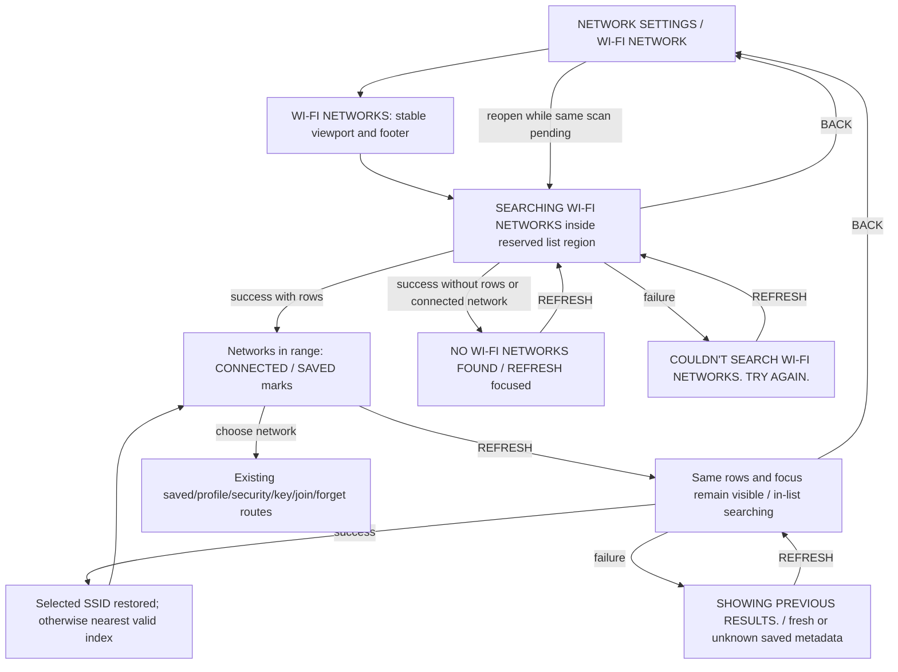

# Proposed canonical flow and copy — UNRUN

For coordinator integration into `docs/es-menu-map.md` Network section and its
exact-source visual index. Do not replace the accepted baseline or label this
flow shipped until the changed binary and frames are qualified.

The two-line status band stays reserved even when success needs no message.
It is outside the scrollable rows but inside the original list region; long
results scroll beneath it without moving the footer. During pending work,
BACK is the only offered controller action and the only clickable button.
REFRESH/manual/row presses neither start a second scan nor write settings.
Returning to the picker while its old job is pending attaches to that job;
late completion has no callback to a deleted screen.

After failure the old network names remain, but marks/actions use the latest
saved/current query answers. Unknown saved metadata retains the existing
CHECK AGAIN NOW? safety route. A successful zero result replaces the old list
and offers REFRESH; it is distinct from failure, which retains old results.
When the selected network vanishes, clamp its prior index to the new final
index. Identical answers keep the same list/scroll; changed answers use native
cursor-centred scrolling. Existing backend join/security rechecks still apply.

No change to connected-first ordering, exact SSID case/spaces, multiple profile
choice, explicit forget confirmation, open-network no-key routing, protected
or unknown key editor, or manual hidden-network entry is intended. These need
their regression transcript and frames; unchanged function bytes do not prove
the new input boundary is correct.

Only these two new catalogue entries are proposed. Existing English strings
and French translations below them remain as recorded in the accepted source.

| New English msgid | Exact proposed French msgstr |
| --- | --- |
| `COULDN'T SEARCH WI-FI NETWORKS. TRY AGAIN.` | `RECHERCHE WI-FI IMPOSSIBLE. RÉESSAYEZ.` |
| `SHOWING PREVIOUS RESULTS.` | `RÉSULTATS PRÉCÉDENTS AFFICHÉS.` |

| Existing English | Existing French |
| --- | --- |
| `SEARCHING WI-FI NETWORKS` | `RECHERCHE DE RÉSEAUX WI-FI` |
| `NO WI-FI NETWORKS FOUND` | `AUCUN RÉSEAU WI-FI TROUVÉ` |
| `COULDN'T CHECK WHICH NETWORKS ARE SAVED.` | `IMPOSSIBLE DE VÉRIFIER QUELS RÉSEAUX SONT ENREGISTRÉS.` |
| `REFRESH` | `RAFRAÎCHIR` |

The original saved-metadata warning moves from the subtitle into the reserved
status band, so it no longer changes the list's bounds. Failure with prior
results joins the two new messages with a newline. Text uses the native row
font, explicit wrapping and a measured two-line height. Width, wrapping, theme
font behavior, both languages and both panel sizes remain frame gates.

Public setup-doc follow-up should describe persistent scan results, explicit
REFRESH retry, the empty/error distinction and BACK while scanning. No wording
should imply a real network connection, immediate scan cancellation, or a
backend-error guarantee before the wifictl pipeline correction is qualified.
